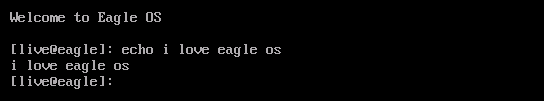

<h1 align="center">Eagle OS</h1>
<p align="center">My small OS, written in FASM (FLAT ASSEMBLER). Current codebase has been recovered from an .img file saved on my computer.</p>
<p align="center">
  
</p>
<h3> How to build and run</h3>

```bash
git clone https://github.com/kirulab-ru/EagleOS.git
cd EagleOS
python build_and_run.py
